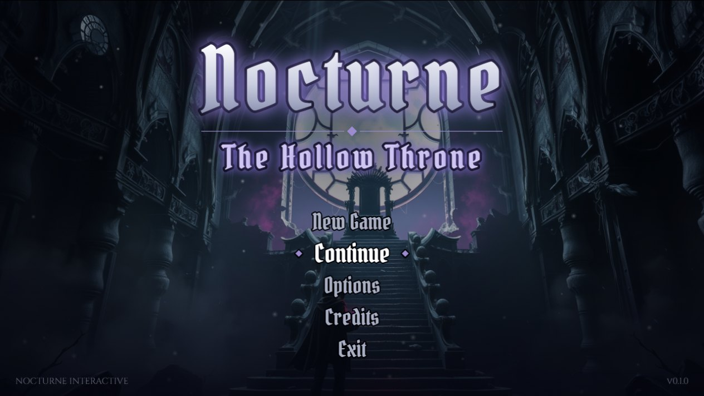
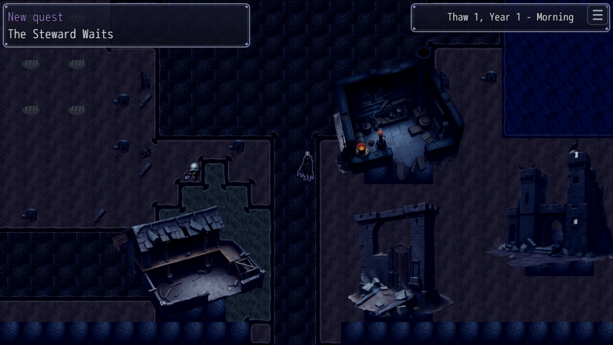
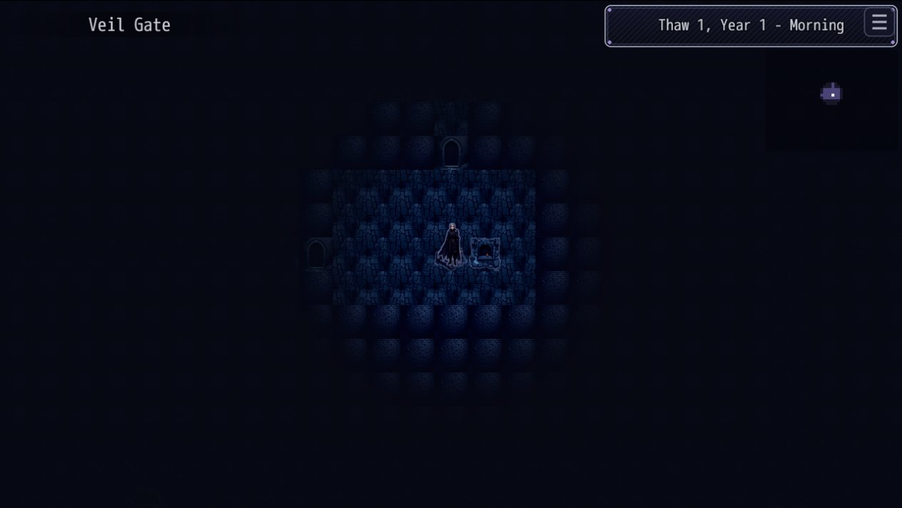
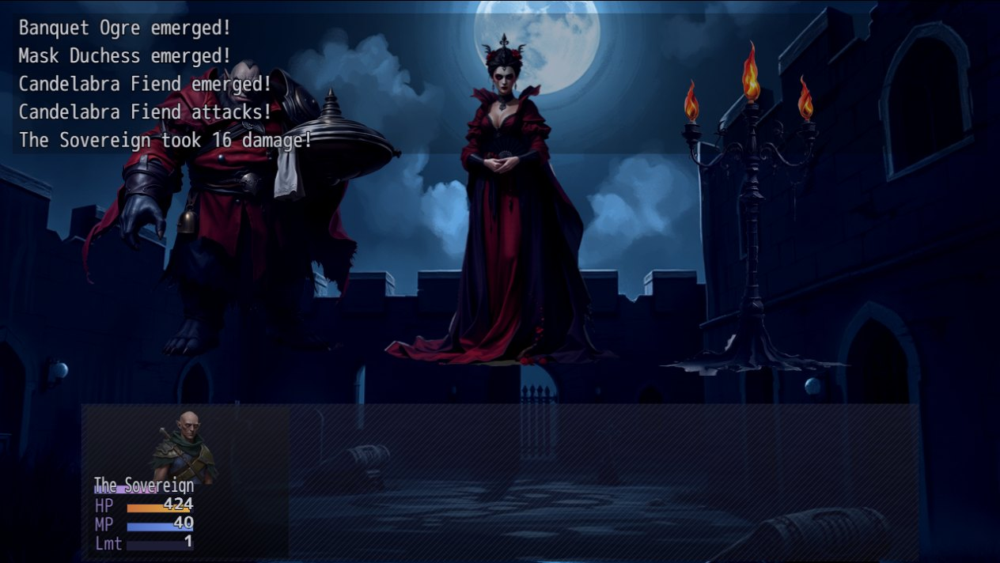
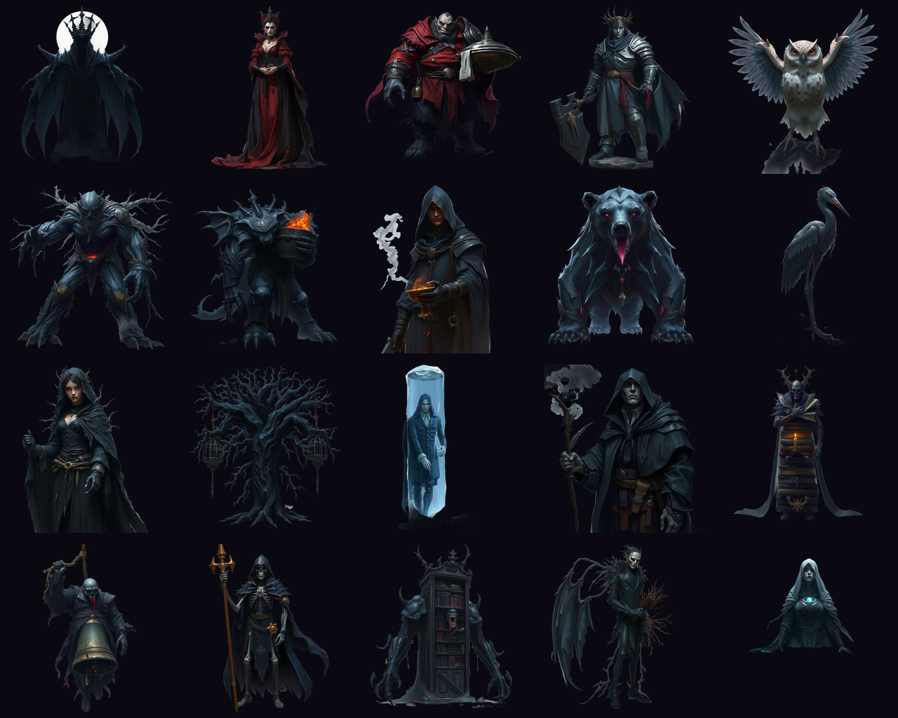
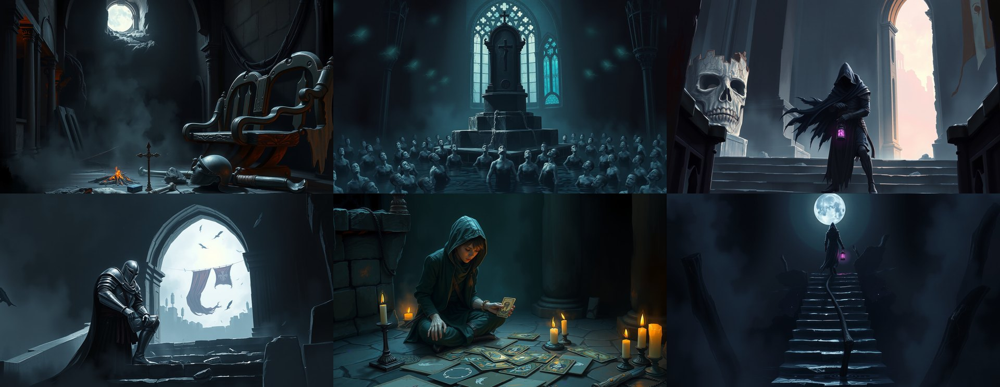
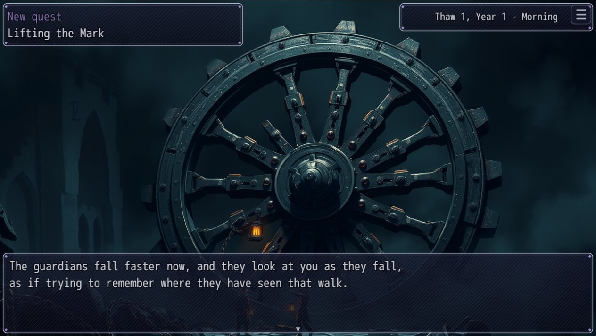
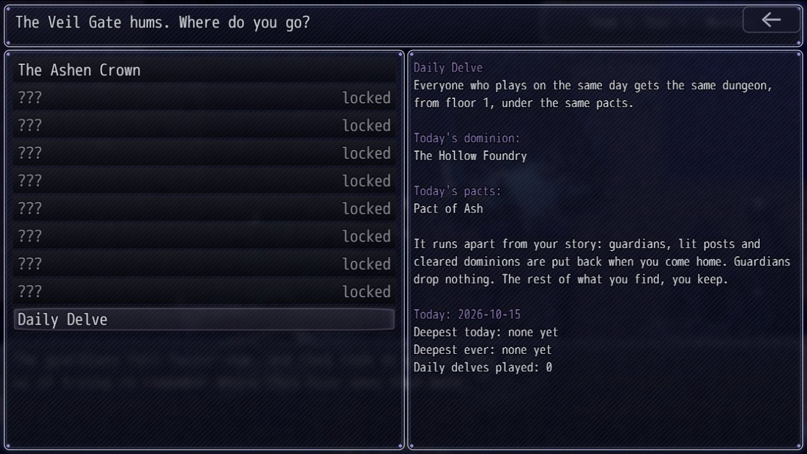
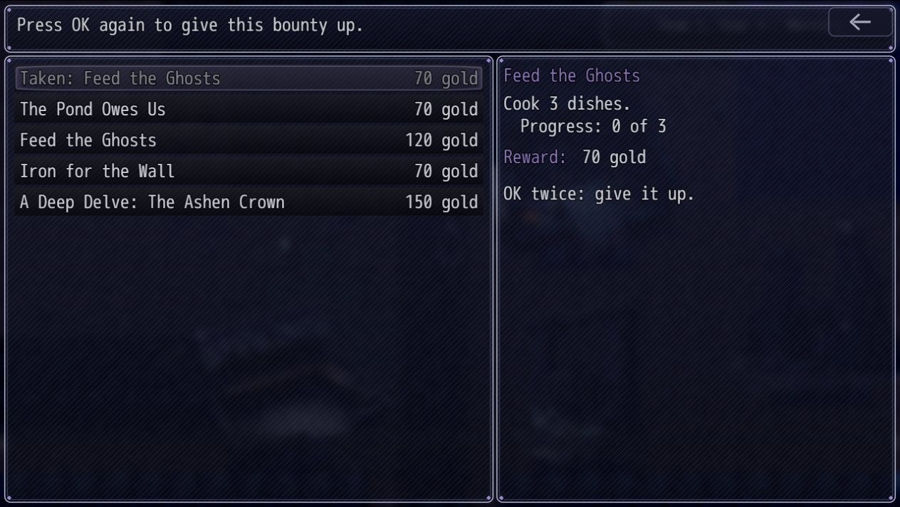

# NOCTURNE: The Hollow Throne

**A dark-fantasy dungeon crawler and homestead.** 
Rebuild a ruined keep by day. Descend nine dominions of a drowned, burning, bone-white underworld by night.

### [Download the latest version](../../releases/latest)

---

## Download

Open **[Releases](../../releases/latest)** and pick your platform from the files at the bottom of the page. (GitHub also lists two "Source code" archives there. They only hold this page and its pictures; the game is the three files below.)

| Platform | File | How to play |
|---|---|---|
| Windows (installer) | `NOCTURNE-The-Hollow-Throne-Setup.exe` | Run it, follow the steps, start the game from the Start menu or desktop shortcut. |
| Windows (zip) | `NOCTURNE-The-Hollow-Throne-windows.zip` | Unzip anywhere, open the folder, run `Game.exe`. |
| Linux (64-bit) | `NOCTURNE-The-Hollow-Throne-linux-x64.tar.gz` | Unpack it, then run `./nocturne.sh` in the folder. |

Nothing to install besides the game itself: it ships with its own runtime. On Linux the usual desktop libraries must be present (GTK 3, NSS, ALSA, X11); on Debian or Ubuntu: `sudo apt install libgtk-3-0 libnss3 libasound2 libxss1 libxtst6`. The Linux build has not been played yet on a real Linux machine, so please report problems.

Saves are kept next to the game (zip and Linux) or in its install folder (installer).

### Updates

The game checks for a newer version each time it starts (it stays silent when you are offline) and offers **Update now**, **Not now** or **Skip this version**. Your saves are never touched. Version 0.1.0 has no updater: install a newer version over it by hand once.

---

## The Sovereign wakes

You come to in the cold hall of **Hollowkeep**, a Sovereign who has lost their own name. A ghost steward named Orrin is the only one who seems glad to see you. The walls are broken, the fields are dead, and under the keep a gate called the **Veil Gate** hums with something that wants you to come down.

By day you are a lord of ruins: till the soil, fish the pond, cook, brew, forge, hire sellswords, raise beasts, restore eight buildings and call the ghosts home. By night the ash host sometimes marches on your walls. And below, nine dominions wait, each 15 floors deep, each rebuilt from a seed every time you enter it.

Everything is dark, quiet and a little wrong.

  
  

## Two lives, one lantern

| Above | Below |
|---|---|
| **The keep.** Four seasons of 28 days, weather, a peddler, a cellar for aging wine and cheese, a barn, a pond, a forge, a chapel, 87 achievements and a Hall of Names for the ghosts you lay to rest. Farm crops can die if you neglect them. Walk the keep freely, in eight directions. | **The Veil Gate.** Nine dominions, 135 floors, lantern light and fog of war, **Dread** that weakens the party the deeper you go, shrines, traps, secret vaults and echoes of the old kingdom. |
| **The company.** You start alone. Rescue four companions in the dungeon or hire up to two sellswords. Each companion has a three-step personal quest line that ends in a unique charm. | **Combat.** Active Time Battle in the manner of FF7: pick spells, arts, heals and items while the clock runs. Limit breaks, eight Hollow Summons, two Gem slots per hero. |
| **The story.** Dreams, letters by raven, 91 Echoes, nine thrones to judge, five endings, and a New Game+ that asks you to swear a Wheel Oath. | **Pacts and bounties.** Hollow Pacts make a delve harder for better rewards; a Notice Board and a weekly Hunt Board keep the work coming; a **Daily Delve** gives everyone the same dungeon each day. |

  

## Nine dominions

| | Dominion | | Dominion |
|---|---|---|---|
| 1 | **The Ashen Crown**, a burnt royal hall | 6 | **The Veilwood**, trees that wear faces |
| 2 | **The Drowned Cathedral**, bells under water | 7 | **The Sunless Archives**, a library that edits you |
| 3 | **The Bone Orchard**, trees that fruit with the dead | 8 | **The Crimson Court**, a banquet that will not end |
| 4 | **The Glass Moors**, a frozen, singing waste | 9 | **The Hollow Throne**, the seat itself |
| 5 | **The Hollow Foundry**, a forge that never cooled | | |

Each has its own tiles, music, battle backgrounds, foes, guardians, signature rooms and a throne whose fate you decide.

### Things that live down there

  

## Told in paintings

Every throne question, dream, ending, the last quest of each companion and each Wheel quest has a full-screen painting behind the text.

  

  
  

## The long game

- **A Notice Board that never runs dry.** Bounties are made up on the spot, three at a time, and a raven keeps bringing letters long after the written ones are read.
- **Turn the Wheel.** After an ending the keep starts over, and each new turn asks for an oath: the dungeon grows harder in one way and richer in another, for good.
- **A Daily Delve.** The same dominion and pacts for everyone on the same date, played apart from your story.
- **Hollow Tarot.** A three-by-three card game with 47 cards and nine opponents, including a rival Sovereign whose story unfolds across four wins.

  

## Made to be played by anyone

Narration (menus, messages and most screens read aloud with the system voice), Toggle Dash, large text, colour-blind colours, high contrast, sound captions, instant text, reduced motion, a low-effects mode, full key and controller remapping, and Xbox and DualSense support with button glyphs that follow the device you use.

Display Mode (Windowed, Fullscreen, Borderless Fullscreen) and Resolution are in Options; **F4** flips between windowed and full screen.

The text is **English, French, German, Spanish and Serbian** (Latin and Cyrillic script; Options > Language). The translations are machine-made first passes.

## Controls

| | Keyboard | Controller |
|---|---|---|
| Move | Arrow keys or W A S D | Left stick or D-pad |
| Confirm | Enter, Z | A / Cross |
| Cancel, open the menu | Esc, X | B / Circle |

Every key and button can be changed in Options.

## Honest status

- **An early build.** All of the content is in and it has been tested by automated tests, but it has not yet been played through by people, so balance, pacing and fun are unproven. If something goes wrong the game says where its `errors.log` is (Options > About and Problems); please send it in with a bug report.
- **Made with AI help.** The code was written with an AI model. The paintings, enemy pictures, music and sound effects were generated with AI tools; the map tiles, sprites, icons and window frames are drawn by scripts.
- **Source.** The game is made with RPG Maker MZ. Its source is not published here.

A game by Nocturne Interactive

